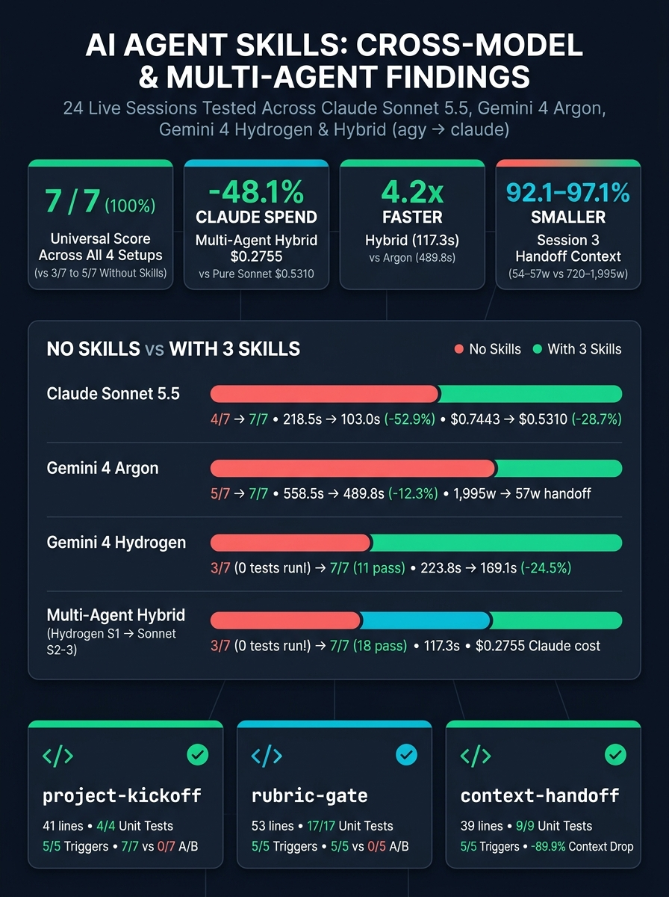

# project-kickoff

**Structured pre-code project kickoff: upfront Q&A + About Me, capped prior-art research, 3 effort/impact ideas per feature, Kill Criteria, MVP-first slicing, persistent docs, and 2–3 feature batching.**

Unguided AI coding sessions often agree sycophantically to scope creep, bury everything in one bloated chat, or forget architectural decisions between sessions. `project-kickoff` prevents all three before a single line of app code is written—keeping `AGENTS.md` under 150 lines, syncing `CLAUDE.md` via `@AGENTS.md`, logging rejected features in a Graveyard, and scoping `MVP v0.1` cleanly.

Zero external dependencies (Python 3 standard library only).

---

## Why Use `project-kickoff`? (Empirical Benchmark Results)

In controlled A/B testing (`claude -p` Sonnet 5.5) on a messy ADHD phone app prompt deliberately loaded with scope creep (*Google Calendar, Apple Reminders, Gmail digests*):

| Metric / Kickoff Check | Without `project-kickoff` | With `project-kickoff` |
| :--- | :--- | :--- |
| **K1. Lean `AGENTS.md` (`<=150` lines)** | `FALSE` (skipped `AGENTS.md`) | `TRUE` |
| **K2. `CLAUDE.md` Sync (`@AGENTS.md`)** | `FALSE` | `TRUE` |
| **K3. `About Me` + `2–3` Feature Batch Rule** | `FALSE` | `TRUE` |
| **K4. `plan.md` MVP + Batches + Effort/Impact Tags** | `FALSE` | `TRUE` |
| **K5. Zero `Effort:L / Impact:Low` in `MVP v0.1`** | `FALSE` | `TRUE` |
| **K6. Research Matrix + Decisions & Graveyard** | `FALSE` | `TRUE` |
| **K7. Calendar/Gmail Excluded from `MVP v0.1`** | `FALSE` | `TRUE` |
| **Score & Turns** | `0 / 7` (`9` turns, `$0.1576`) | **`7 / 7` (`6` turns — `-3` fewer turns!, `$0.1829`)** |

* **Trigger Precision (`U2`):** `5 / 5` (`3/3` kickoff prompts triggered; `0/2` false positives on tiny edits).
* **Cross-Model 3-Session Pipeline (`24` Live Sessions):** When paired with `rubric-gate` and `context-handoff`, **all 4 architectures (`Sonnet 5.5`, `Argon`, `Hydrogen`, and `Multi-Agent Hybrid`) hit `7 / 7 (100%)`**. In `Hydrogen` and `Hybrid`, the unguided baseline literally shipped `0` runnable tests (`exit=5`), while the 3-skill Hybrid pipeline cut Claude spend by **`48.1%`** (`$0.2755` vs. Pure Sonnet `$0.5310`).



Raw benchmark logs: [`tests/live_eval_results.json`](./tests/live_eval_results.json) · [`docs/benchmarks/sonnet_3session_results.json`](./docs/benchmarks/sonnet_3session_results.json) · [`docs/benchmarks/cross_model_matrix_results.json`](./docs/benchmarks/cross_model_matrix_results.json)

---

## Quick Start & Installation

### Antigravity (`agy`) & Claude Code (`claude`)
* **Antigravity:** Register in `~/.gemini/config/skills.json` or place under `.agents/skills/project-kickoff/`.
* **Claude Code:** Symlink into `~/.claude/skills/project-kickoff`:
  ```bash
  ln -s /path/to/project-kickoff ~/.claude/skills/project-kickoff
  ```

---

## Core Tools & Variable Scaffolding

1. **Variable Complexity Scaffolder** ([scripts/scaffold_project.py](./scripts/scaffold_project.py)):
   * **`SKIP`:** `<3` files, trivial task → creates `0` docs.
   * **`LIGHT`:** Small feature → creates `AGENTS.md` (`<150` lines), `CLAUDE.md` (`@AGENTS.md`), and `plan.md`.
   * **`FULL`:** Multi-session / new integrations → adds `research.md` and `decisions.md` (`Answered Questions` + `Kill Criteria & Graveyard`).
   ```bash
   python3 scripts/scaffold_project.py --project-dir . --name "adhd-capture" --tier FULL --goal "Capture -> Organize -> Ask Later" --mvp-slice "1-tap phone capture + SQLite"
   ```
2. **Kickoff Validator** ([scripts/validate_kickoff.py](./scripts/validate_kickoff.py)) — Verifies `K1`–`K6` rules automatically (`AGENTS.md` line count, `@AGENTS.md`, `Effort/Impact` tags, and no `Effort: L + Impact: Low` leaks in `MVP v0.1`).
   ```bash
   python3 scripts/validate_kickoff.py . --tier FULL
   ```

---

## Verification (Runs Locally in <0.1s, `$0` Cost)

```bash
python3 -m unittest discover -s tests -v
python3 -m compileall -q scripts tests
```
All `4 / 4` unit tests pass using Python 3 standard library only.
